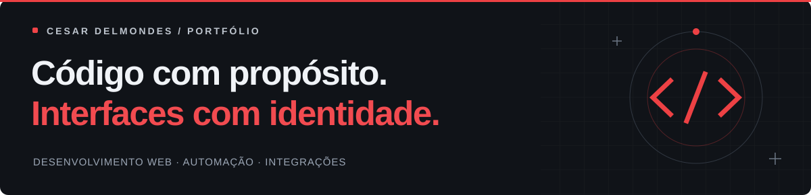
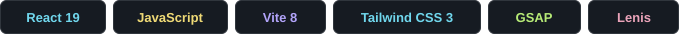
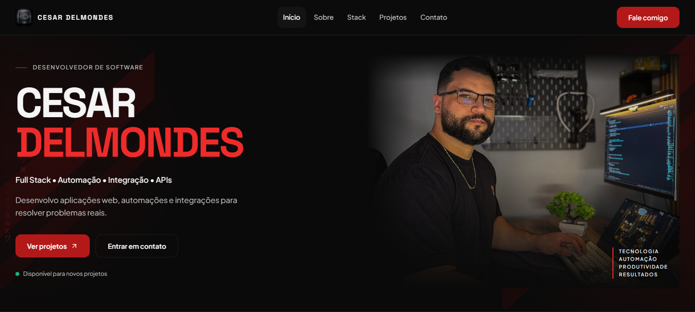

<p align="center">
  
</p>

<p align="center">
  Portfólio de desenvolvimento web, automação e integração de sistemas.<br />
  Uma seleção de projetos, das necessidades reais às soluções em código.
</p>

<p align="center">
  <a href="https://cesarddev.com.br"><strong>Explorar o portfólio ↗</strong></a>
  &nbsp; · &nbsp;
  <a href="#executar-localmente">Executar localmente</a>
  &nbsp; · &nbsp;
  <a href="https://www.linkedin.com/in/cdelmondes/">LinkedIn</a>
</p>

<p align="center">
  
</p>

<br />

[](https://cesarddev.com.br)

## Sobre o projeto

Este repositório reúne o código do meu portfólio pessoal: uma aplicação em **React e JavaScript**, construída para apresentar minha trajetória, minhas especialidades e os projetos que desenvolvo.

Cada projeto é apresentado com **problema, solução e impacto**, conectando decisões técnicas ao contexto de uso. A identidade visual combina tons escuros, detalhes em vermelho e animações que acompanham a navegação.

## Experiência e recursos

| Apresentação | Implementação |
| :--- | :--- |
| **Projetos com contexto** | Sete projetos, detalhes expansíveis e links para código e demonstrações disponíveis. |
| **Navegação responsiva** | Menu móvel, destaque da seção ativa e acesso rápido às seções do portfólio. |
| **Movimento com controle** | Animações com GSAP, rolagem com Lenis e efeito de caracteres em Canvas com opção de pausa. |
| **Acessibilidade** | Link para pular ao conteúdo, rótulos acessíveis e suporte à preferência por movimento reduzido. |
| **Compartilhamento** | Metadados Open Graph, Twitter Card, URL canônica e dados estruturados. |

## Tecnologias

**React 19 + JavaScript** na interface, **Vite 8** no ambiente de desenvolvimento e build, **Tailwind CSS 3** na estilização, **GSAP + ScrollTrigger** nas animações e **Lenis** na rolagem. Ícones com **Lucide React** e **React Icons**; qualidade de código com **ESLint**.

## Executar localmente

**Pré-requisitos:** Git, npm e Node.js 22.12+ em uma versão compatível com o Vite 8.

```bash
git clone https://github.com/Cesare221/New_portfolio.git
cd New_portfolio
npm ci
npm run dev
```

Abra o endereço indicado pelo Vite no terminal. O portfólio funciona como uma aplicação frontend e não exige credenciais de API para execução local.

| Comando | Finalidade |
| :--- | :--- |
| `npm run dev` | Inicia o servidor de desenvolvimento. |
| `npm run build` | Gera a versão de produção em `dist/`. |
| `npm run preview` | Serve o build de produção localmente. |
| `npm run lint` | Verifica o código com ESLint. |
| `npm test` | Valida dados dos projetos e metadados do site. |

## Organização

```text
src/
├── components/       # Seções da página e componentes de interface
├── data/             # Perfil, projetos, tecnologias e metadados
├── App.jsx           # Navegação e composição da página
└── index.css         # Estilos globais e identidade visual
public/               # Imagens, ícones e arquivos estáticos
scripts/              # Validação dos dados do portfólio
```

O conteúdo principal fica em [`src/data/portfolio.js`](src/data/portfolio.js). Os metadados estão em [`src/data/siteMeta.js`](src/data/siteMeta.js) e [`index.html`](index.html).

---

<p align="center">
  <strong>Vamos construir algo juntos?</strong><br />
  Aberto a oportunidades, colaborações e novos projetos.
</p>

<p align="center">
  <a href="mailto:cesard.dev@gmail.com">E-mail</a> &nbsp; / &nbsp;
  <a href="https://www.linkedin.com/in/cdelmondes/">LinkedIn</a> &nbsp; / &nbsp;
  <a href="https://github.com/Cesare221">GitHub</a> &nbsp; / &nbsp;
  <a href="https://cesarddev.com.br">Portfólio</a>
</p>

<p align="center"><sub>Desenvolvido por Cesar Delmondes.</sub></p>
